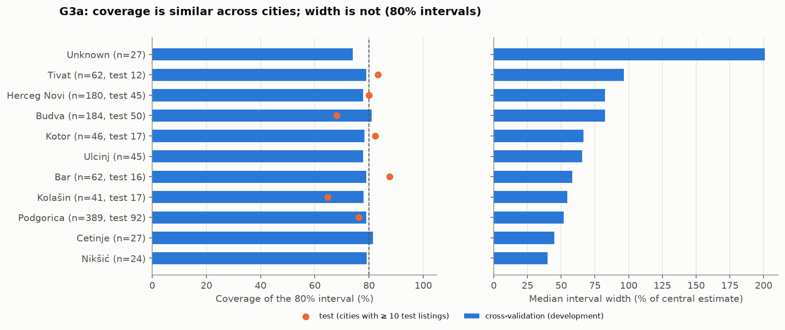

# VALORA AI: Apartment Asking Price Estimation and Prediction Uncertainty in Montenegro

VALORA AI is a data science research project examining how accurately apartment asking prices in Montenegro can be estimated from available property characteristics, and how reliably prediction uncertainty can be quantified.

## The problem

Asking prices of apartments in Montenegro differ strongly between Podgorica, the coast and the north. Public price statistics at municipality level are hard to find, and estimating a price usually means comparing adverts by hand.

This project uses **1,376 real apartment sale adverts** to answer:

> **How accurately can we estimate apartment asking prices in Montenegro, and how reliably can we quantify the uncertainty of these predictions?**

Sub-questions:
- Can machine learning improve on a simple city price-per-m² rule?
- How much does location data quality contribute?
- Can quantile regression provide informative prediction intervals?

The question was refined during the research. My original project asked whether machine learning can estimate asking prices. The comparison with a simple rule and the uncertainty question were added after the first results (see [docs/research_history.md](docs/research_history.md)).

The target is the price written in an advert: an **asking price**, not a sale price and not a certified valuation.

## Key results

1. **A simple, transparent rule is as accurate as the machine-learning models tested.**
   - The selected method is "the city's median asking price per m² × the apartment's area".
   - Cross-validation MAE: **€50,527**.
   - On the 278-listing retrospective internal test set: MAE **€57,478**, R² 0.469.
   - The best conventional machine-learning candidate, a Ridge regression on log price, reached a CV MAE of €51,595 (within one standard error of the rule).
   - Later hybrid "rule + learned correction" models did not improve on the rule either.
2. **Location data quality mattered most.** Cleaning the location text reduced unknown cities from 49% to 2.4% of adverts. With the same Random Forest model, the test MAE fell from €62,402 to €56,490.
3. **Quantile regression quantifies the uncertainty.** Linear quantile regression on log price (G3a) produces prediction intervals:

   | Nominal level | Coverage (CV) | Coverage (test) | Median relative width (CV / test) |
   |---|---|---|---|
   | 80% | 78.9% | 74.8% | 64% / 64% |
   | 90% | 89.0% | 86.0% | 85% / 81% |

   - The width is the **total** range divided by the central estimate. The ranges are asymmetric, so 64% does not mean ±32%.
   - The simple empirical baseline G1 (city €/m² percentiles × area) reaches the **same 74.8% test coverage** at 80%, with slightly **narrower** ranges (59%).
   - G3a has the better interval score, which combines width and misses: €288k vs €303k on the test set; €250k vs €261k in CV.
   - Ranges are about half as wide in continental cities as on the coast.
   - They contain only about half of the asking prices of flats priced at **€500,000 or more** (50% in CV, 45% on the test set).
4. **Rare quantile crossing.** The lower and upper bounds never cross. In 1 of 278 test listings and 3 of 2,196 CV cases, the separately fitted median lies just outside its own range. This is documented, not corrected afterwards.



*Example: for a 70 m² flat, the 80% range is €149k–€257k in Podgorica, €102k–€163k in Nikšić, €174k–€373k in Budva and €225k–€479k in Tivat. These are ranges for asking prices, not valuations.*

## The data

| Dataset | Source | Size | Period | Terms |
|---|---|---|---|---|
| `VALORA_AI_FINAL_COLAB.csv` | I collected public adverts from **Realitica** and **Estitor**. The file also contains simulated, generated and professional-appraisal rows | 6,913 rows, of which **1,986 are real adverts** | Not documented (no dates in the data) | Not documented; contains sensitive appraisal file paths. **Not included in this repository** |
| `valora_cleaned_step2.csv` | My earlier, partly cleaned version of the same data | 4,036 rows | as above | as above; **not included** |

- **Real adverts only.** 2,000 simulated rows were mislabelled as online listings and had to be detected using several columns.
- **Cleaning:** removing rentals, errors and 47 identical re-posts leaves **1,376** apartment sale adverts.
- **Probable duplicates:** 74 further groups of probable duplicates are kept, but never split between training and test data. Duplicate detection is heuristic (exact matches only), so some repeated adverts with small changes may remain.
- **Further reading:** [data/README.md](data/README.md) (acquisition) and [docs/privacy_and_data_rights.md](docs/privacy_and_data_rights.md) (privacy and data rights).

## How to navigate this repo

1. [EDA notebook](notebooks/01_eda.ipynb): data sources, cleaning (6,913 → 1,376), location repair, and price patterns by city.
2. [Modelling notebook](notebooks/02_modelling.ipynb):
   - baselines, models and the location experiment;
   - model choice and test (sections 3–8.6);
   - additional research (8.7);
   - prediction intervals (8.8–8.9, 9.2, 10).
3. [docs/](docs/README.md):
   - [data quality audit](docs/data_quality_audit.md)
   - [research history](docs/research_history.md)
   - [validation report](docs/validation_report.md)
   - [additional research archive](docs/research/README.md)

## How to reproduce

Place a local copy of both data files in `data/raw/`:

```text
data/raw/VALORA_AI_FINAL_COLAB.csv   main source of the analysis
data/raw/valora_cleaned_step2.csv    earlier cleaning step; used only for the comparison in the EDA appendix and by the data tests
```

Then, with Python 3.11:

```bash
python -m venv .venv
.venv\Scripts\activate            # Windows  (macOS/Linux: source .venv/bin/activate)
python -m pip install -r requirements.txt
python -m pip check

# run the two notebooks in order, each in a fresh kernel
python -m jupyter nbconvert --to notebook --execute --inplace notebooks/01_eda.ipynb
python -m jupyter nbconvert --to notebook --execute --inplace notebooks/02_modelling.ipynb

# automatic checks (fast); add  -m slow  to re-run both notebooks in a clean temporary copy
python -m pytest
```

- `01_eda.ipynb` checks both files' checksums and writes `data/processed/valora_apartments_clean.csv`. `02_modelling.ipynb` reads only that file.
- In the last validation, EDA took about **29 seconds** and modelling about **556 seconds**, with parallel work limited to 2 processes. Run times depend on the computer.
- The workflow was tested locally with Jupyter. It has **not** been tested in Google Colab.

## Limitations

- **Asking prices, not sale prices or valuations.**
- **Not a representative sample.** Estitor covers only Podgorica (at most 20 adverts per neighbourhood), and small towns have few adverts.
- **No dates.** Trends and forecasts are not possible with these data.
- **Few inputs.** Condition, floor, view and exact location are not available. Expensive flats are underestimated and often fall above their ranges.
- **The test set is not untouched.** I had explored this dataset and its test results in earlier notebooks, and a development smoke test included these rows. Test results are retrospective internal checks, **not** independent external validation.
- **No formal guarantee.** Interval coverage is an empirical estimate: lower on the test set (74.8%) than in cross-validation (78.9%).
- **Heuristic duplicate detection.** Repeated adverts with small changes may remain.
- **Unconfirmed data rights.** The platforms' terms and the right to share the data are not documented.

## Repository structure

```text
README.md                  This page
LICENSE                    MIT licence for the code (not the data)
requirements.txt           Tested package versions
pytest.ini, tests/         Automatic data, leakage, modelling, interval, privacy and notebook checks
.gitignore                 Keeps data, listing-level outputs, private files and models out of Git
data/
  README.md                How to obtain and place the data
  raw/                     Place for the original files (+ README with checksums)
  reference/               Settlement -> municipality table (Monstat 2023 evidence)
  processed/               Outputs of 01_eda.ipynb (+ data dictionary)
notebooks/
  01_eda.ipynb             Exploration, cleaning, export
  02_modelling.ipynb       Estimation, model choice, prediction intervals, error analysis
src/                       Shared cleaning, modelling, interval and chart helpers
docs/                      Figures, aggregate results, audit, history, validation, privacy,
                           interval test protocol, additional research archive (docs/research/)
archive/                   My original notebooks and README (historical record)
```

## Contributions and acknowledgements

- **My work:**
  - I developed the research idea;
  - I collected the online adverts from Realitica and Estitor, and assembled the dataset;
  - I wrote the first exploratory notebook and five modelling experiments (Linear Regression, Random Forest, Random Forest with feature engineering, tuned Random Forest, Extra Trees).

  These are kept in [archive/](archive/README.md) and described in [docs/research_history.md](docs/research_history.md).
- **Assistance:** the reorganisation into this two-notebook structure, the data-quality corrections, the re-evaluation protocol, the additional research phases, the prediction-interval analysis, the automatic tests and the documentation were prepared with the help of an AI assistant (Claude, Anthropic). As the author, I am responsible for reviewing and understanding all methods, decisions and results presented here.
- **Data sources:** Realitica (realitica.com), Estitor (estitor.com), and Monstat (Statistical Office of Montenegro), *Spisak naselja Crne Gore 2023*, for the settlement register.
- **Template:** the instructor's capstone template (`dsb_cap_template`).
- **Libraries:** pandas, NumPy, scikit-learn, matplotlib, Jupyter, pytest.

## License

The **code** is released under the MIT License (see [LICENSE](LICENSE)). The licence does **not** cover the data: the terms of the scraped adverts and the appraisal reports are not documented, so the data are not redistributed (see [docs/privacy_and_data_rights.md](docs/privacy_and_data_rights.md)). No pretrained models are used.


