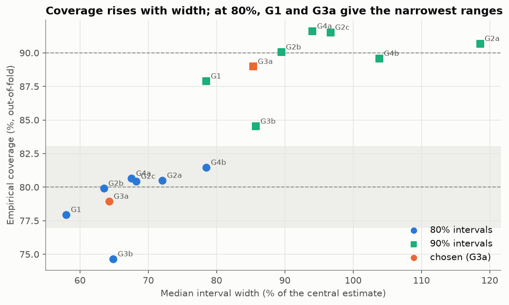
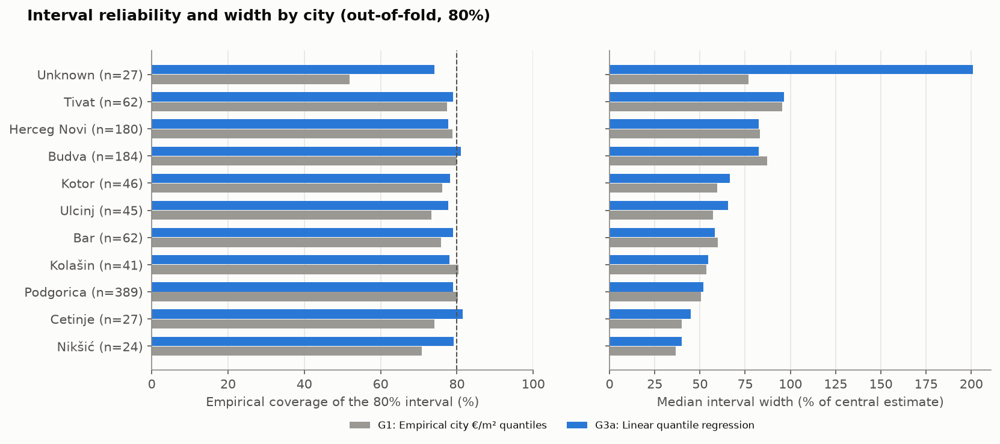
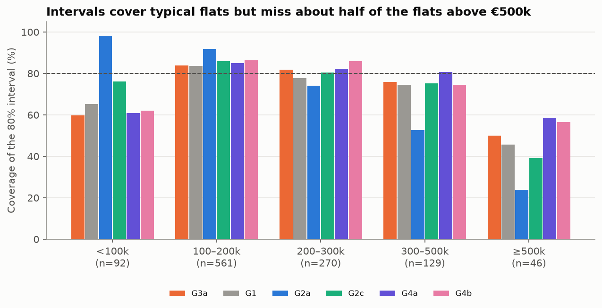

# VALORA AI: Price ranges and prediction uncertainty, final report

**Type:** exploratory cross-validation research, the last additional direction.
**Approval condition:** the supervisor approved execution on the condition that the student confirms the research question and that the course rules allow this help. Neither can be checked from this workspace.
**Reproduce:** `uncertainty_research.ipynb` (≈ 50 s; deterministic, re-run with identical results). The plan was fixed before execution: `EXPERIMENT_PLAN.md`, checksum recorded at 2026-11-20T10:08:45Z.
**Protected folders:** `valora_ai/`, `research_extension/` and `research_opportunities/` were not changed (see Section 8).

## 1. Bottom line

- **An honest estimate of an apartment's asking price is a range, and a fairly wide one.**
  - Linear quantile regression on log price (**G3a**) gives 80% ranges that contain **78.9%** of unseen development listings, with **similar coverage in every city** (0.78–0.81).
  - The median width is **64% of the central estimate** (pre-set label: *moderate*):
    - ≈ 40–55% in continental cities (Nikšić, Cetinje, Podgorica, Kolašin);
    - ≈ 80–97% on the coast (Herceg Novi, Budva, Tivat).
- **Weak points:**
  - flats ≥ €500k (n = 46) are covered only **50%** of the time, and the misses are above the range;
  - flats < €100k are covered 60% of the time.
- The simplest method, **empirical city €/m² quantiles × area (G1)**, is close behind (77.9% coverage, 58% width), but its coverage is less even across cities.

## 2. Evaluation frame
- **Data:**
  - only the 1,098 primary development listings and the existing 5 group-aware outer folds (fingerprint `dd9f21b7d8b6`);
  - **the 278 test listings were never loaded** (asserted in code).
- **Split conformal and CQR:** each outer training fold is split by groups into fit (≈ 75%, ≈ 660 listings) and calibration (≈ 25%, ≈ 220). Outer-validation listings are only used for evaluation. G1 and G3 fit on the whole training fold (≈ 880).
- **Calibration:** finite-sample conformal quantile k = ⌈(n+1)(1−α)⌉.
- **Size of the study:** 8 pre-defined configurations at 80% (main) and 90%. Quantile crossing: none.

## 3. Results (80%, mean over 5 folds)

| Method | Coverage (± std) | Group coverage | Median width (% of estimate) | Interval score | Pinball | Central MAE | Fit time |
|---|---|---|---|---|---|---|---|
| **G3a Linear quantile regression** (chosen) | **78.9% ± 3.6** | 78.7% | **64%** | **€250.4k** | €12.5k | €50,855 | 1.9 s |
| G4a CQR on linear QR | 80.6% ± 5.2 | 80.2% | 68% | €256.9k | €12.8k | €50,968 | 1.5 s |
| G1 Empirical city €/m² quantiles | 77.9% ± 3.0 | 77.6% | 58% | €261.3k | €13.1k | €50,527 | 0.1 s |
| G2c Conformal, log residual | 80.4% ± 5.8 | 79.5% | 68% | €273.1k | €13.7k | €51,078 | 0.1 s |
| G3b Quantile gradient boosting | 74.6% ± 2.4 ✗ | 74.1% | 65% | €273.8k | €13.7k | €54,754 | 9.5 s |
| G2b Conformal, relative residual | 79.9% ± 6.2 | 79.3% | 64% | €276.6k | €13.8k | €51,078 | 0.1 s |
| G4b CQR on quantile GB | 81.5% ± 4.1 | 81.0% | 79% | €289.4k | €14.5k | €57,672 | 9.3 s |
| G2a Conformal, absolute residual | 80.5% ± 2.9 | 79.3% | 72% | €318.0k | €15.9k | €51,078 | 0.1 s |

✗ = outside the acceptable coverage band (77–83%).

**90%:**

| Method | Coverage | Median width (% of estimate) |
|---|---|---|
| G3a | 89.0% | 85% |
| G1 | 87.9% (below 90%) | 79% |
| G4a | 91.6% | 94% |
| G2c | 91.5% | 97% |

**Selection (pre-registered rule):**
- 7 methods are acceptable.
- The best interval score belongs to G3a. No other method is within one paired SE: G4a +€6.5k (SE €3.4k), G1 +€10.8k (SE €7.6k).
- **Chosen: G3a.** Width alone did not decide: G1 is narrower, but it misses more and more severely.

## 4. Geography (80%, out-of-fold)

| City | n | G3a coverage | G3a median width | G1 coverage |
|---|---|---|---|---|
| Nikšić | 24 | 0.79 | 40% | 0.71 |
| Cetinje | 27 | 0.81 | 45% | 0.74 |
| Podgorica | 389 | 0.79 | 52% | 0.80 |
| Kolašin | 41 | 0.78 | 54% | 0.80 |
| Bar | 62 | 0.79 | 58% | 0.76 |
| Kotor | 46 | 0.78 | 66% | 0.76 |
| Ulcinj | 45 | 0.78 | 66% | 0.73 |
| Budva | 184 | 0.81 | 83% | 0.80 |
| Herceg Novi | 180 | 0.78 | 83% | 0.79 |
| Tivat | 62 | 0.79 | 97% | 0.77 |
| Unknown city | 27 | 0.74 | 201% | 0.52 |

- **Coastal** (Herceg Novi, Kotor, Tivat, Budva, Bar, Ulcinj; n = 579): G3a coverage 0.79, width 80%.
- **Continental** (n = 492): coverage 0.79, width 52%.
- **Conformal intervals around the rule do not adapt by city:** they over-cover Podgorica (0.87–0.90) and under-cover coastal cities (0.65–0.80).
- **Small cities** (Nikšić, Cetinje): too few listings for firm conclusions.

## 5. Expensive and large flats (actual price used only afterwards)

| Price band | n | G3a coverage | Above upper bound | Median width |
|---|---|---|---|---|
| < €100k | 92 | 0.60 | 7% (33% below) | €50k |
| €100–200k | 561 | 0.84 | 4% | €92k |
| €200–300k | 270 | 0.82 | 14% | €156k |
| €300–500k | 129 | 0.76 | 22% | €275k |
| ≥ €500k | 46 | **0.50** | **50%** | €431k |

- **All methods miss expensive flats from below.** The best is G4a with 41% above the range.
- **Absolute intervals (G2a)** use the same ≈ €137k width for every flat: 98% coverage for cheap flats, 24% for ≥ €500k. **Relative and log-scale intervals fit the data much better.**
- **Flats ≥ 120 m² (n = 63):** G3a covers 73%, G2a 40%.

## 6. Dependence and exchangeability
- **Coverage per listing vs per property:** 0.790 per listing and 0.787 per repeat group; practically the same.
- **Repeated listings:** listings in multi-listing groups are covered at 0.826 (n = 132), single listings at 0.785.
- **Fold variation:** coverage ranges from 0.75 to 0.84, so ±4 percentage points of sampling noise is normal.
- **No formal guarantee:**
  - Split-conformal guarantees require **exchangeability**. That is doubtful here: a convenience sample from three platforms, dependent repeat groups, unknown time order.
  - G3a has no finite-sample guarantee at all.
  - All coverages are therefore **empirical, cross-validated** values, not guarantees for any city or flat.

## 7. Secondary: listings for manual review
- **Development listings:**
  - 121 (11%) are outside G3a's 90% interval, mostly in the price tails (33% of flats < €100k, 30% of flats ≥ €500k);
  - 15 (1.4%) have |MAD z| > 3.5;
  - only **1 of 24** student "check" flags overlaps.
- **Retrospective check** of the 46 known errors removed earlier (never used for fitting):
  - all 36 rentals, both price conflicts and the 1 m² flat are flagged;
  - only 3 of the 7 misclassified houses are flagged;
  - the gross errors are also caught by a simple price rule or by the student's own check.
- **Isolation Forest was not run** (pre-registered: no reliable validation labels).
- **Conclusion:** limited added value. Flags are only candidates for review, never "overpriced", "bargain" or "fraud". **Future work.**

## 8. Integrity
- **Protected folders:** SHA-256 manifests of `valora_ai/` (101 files), `research_extension/` (26) and `research_opportunities/` (10) are identical before and after: see `checks/*_manifest_BEFORE/AFTER.sha256` and `checks/integrity.txt`.
- **Final-project tests:** re-run in a separate copy: **69 fast tests passed, 0 failed** (`checks/final_project_tests_in_copy.txt`). The slow from-scratch test was not repeated, because `valora_ai/` is byte-identical to the version on which all 70 tests passed in the research-extension phase.
- **Other:** no Git operations, no publication, no other projects accessed.
- **Deviations from the plan:**
  - Explanatory text was written after the results and checked against them.
  - Four chart layouts and titles were corrected after viewing, including a title that overstated a result ("miss most flats" → "miss about half").
  - The notebook was run three times with identical results.
  - **No configuration, level, split, seed, threshold or data rule was changed.**

## 9. Answers

| # | Answer |
|---|---|
| 1 | Can we predict useful ranges? **Partly.** Honest and even 80% coverage; moderately wide overall, informative inland, wide on the coast, unreliable above €500k. |
| 2 | Best balance? **G3a, linear quantile regression** (best interval score, even city coverage); G1 is the simplest close alternative. |
| 3 | Does quantile regression add value? **Yes, for ranges** (adaptive width); not for the point estimate (MAE ≈ the rule). The gradient-boosting version under-covers. |
| 4 | Does conformal prediction help? **Overall coverage, yes; city-level reliability, no.** CQR adds little to G3a. No formal guarantee here. |
| 5 | Most reliable cities? Coverage is similar everywhere. The ranges are **most informative** in Nikšić, Cetinje, Podgorica and Kolašin, and least in Tivat, Budva and Herceg Novi. |
| 6 | Width for expensive flats? ≈ €431k median for flats ≥ €500k, yet only 50% are covered. |
| 7 | Manual-review flags? Only gross errors are found, and simple rules find them too. **Future work.** |
| 8 | What to present? Coverage vs width; city reliability and width; example ranges; high-price coverage. Message: *"An honest estimate is a range: about ±25% inland and ±40–50% on the coast; reliable for typical flats, not for luxury flats."* |
| 9 | Research question? *How accurately can we estimate apartment asking prices in Montenegro, and how reliably can we quantify the uncertainty of these predictions?* It fits the findings. It must be stated that the interval part was added after the earlier phases. |
| 10 | Include in the final notebooks? **Recommended as a compact addition** (G1 + G3a, CV coverage and width, city chart, examples; labelled exploratory). **Optional, needs approval:** one pre-registered evaluation of G3a and G1 on the 278 test listings, which were never used for intervals. That would be the most honest check still available. |

## 10. Still pending from earlier phases (not changed)
- **Correction of the tree-model statement** in the final project. On the test set, trees looked better on large errors; this did not replicate in CV (research extension).
- **Student confirmations:**
  - the settlement mappings;
  - the research question;
  - data rights;
  - the course rules on AI assistance.

## Files

| File | Content |
|---|---|
| `uncertainty_research.ipynb` | Reproducible notebook (every code cell explained) |
| `lib/ux.py` | Interval methods and metrics |
| `results/summary_80.csv`, `summary_90.csv`, `fold_metrics.csv`, `selection.json` | Main results |
| `results/by_city_80.csv`, `by_region_80.csv`, `high_price_analysis_80.csv` | Conditional coverage |
| `results/demonstrations.csv` | Example ranges |
| `results/review_candidates_dev.csv`, `retrospective_known_errors.csv` | Secondary screening (IDs, city, area, rooms and prices only; no text or URLs) |
| `figures/ux_01`–`ux_05` | Coverage vs width, actual vs intervals, city reliability, high-price coverage, example ranges |
| `checks/` | Plan checksum, folder manifests, integrity and test results |
